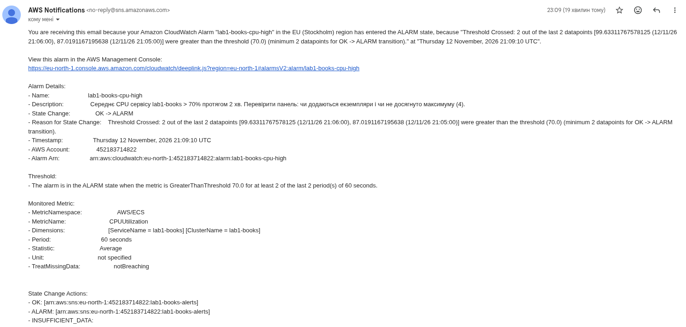
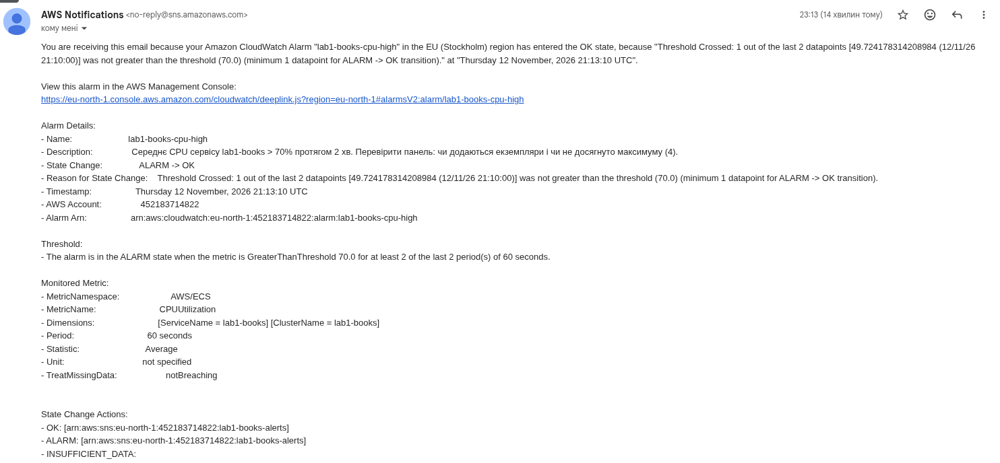

# Сповіщення (завдання 4)

Terraform: [`infra/monitoring.tf`](../infra/monitoring.tf) — `aws_cloudwatch_metric_alarm.cpu_high`,
канал — `aws_sns_topic.alerts` + `aws_sns_topic_subscription.email` (протокол `email`, адреса `alert_email`).
Після першого `apply` треба підтвердити підписку за посиланням у листі від AWS Notifications, інакше листи не доставляються.

## Умова

| Параметр | Значення |
|---|---|
| Метрика | `AWS/ECS` `CPUUtilization`, вимірі `ClusterName`, `ServiceName`, статистика **Average** |
| Поріг | **> 70 %** (`cpu_alarm_threshold`) |
| Вікно | `period = 60`, `evaluation_periods = 2`, `datapoints_to_alarm = 2` → **2 хвилини поспіль** |
| `alarm_actions` | SNS → лист «ALARM» (перевантаження) |
| `ok_actions` | SNS → лист «OK» (повернення до норми) |
| `treat_missing_data` | `notBreaching` — відсутність даних (сервіс простоює) не вважається проблемою |

### Обґрунтування

* **Чому CPU, а не p95.** Сервіс CPU-обмежений (Python, 0.25 vCPU; запити до БД швидкі — індекс за `id`),
  тож CPU — найраніший індикатор перевантаження, і саме на нього налаштоване масштабування — алярм перевіряє,
  чи масштабування встигає. Для сервісу, що чекає на БД, краще було б сповіщення на латентність p95 > 500 мс
  (вона ближча до досвіду користувача).
* **Чому 70 %, а не 60 %.** 60 % — ціль масштабування, CPU її регулярно торкається під час нормальної роботи.
  70 % протягом 2 хвилин означає, що наявних екземплярів уже бракує, а нові ще не з'явились або досягнуто максимуму (4).
* **Чому «протягом 2 хв».** Одинична точка понад поріг (GC, холодний старт задачі, сплеск) — не інцидент.
  Дві точки поспіль відсікають шум і flapping, але все ще дають реакцію за кілька хвилин.

## Знімки листів

## Час реакції

| Подія | Час (UTC) |
|---|---|
| Початок сталого навантаження (кінець наростання, +2:30 від старту k6) | `__:__:__` |
| Перехід алярму в ALARM (історія алярму в CloudWatch) | `__:__:__` |
| Лист ALARM отримано | `__:__:__` |
| Початок спаду | `__:__:__` |
| Лист OK отримано | `__:__:__` |

**Від початку сталого навантаження до першого листа: `__` хв.** (CPU перетинає 70 % ще під час наростання,
тож лист може прийти й раніше за кінець наростання — тоді вказати час від моменту перетину порогу.)

Складові затримки:

1. CPU-метрика ECS агрегується за 1 хв і з'являється в CloudWatch із затримкою ~1 хв;
2. 2 точки поспіль вище порогу — ще 2 хв;
3. CloudWatch оцінює алярм раз на хвилину — до 1 хв;
4. SNS → поштовий сервер — зазвичай секунди, до хвилини.

Очікувано **3–5 хв** від початку перевищення до листа.

### Чи прийнятно це для реального сервісу

Для навчального сервісу й для сповіщення типу «масштабування не встигає» — так: 3–5 хв приблизно відповідають часу,
за який автомасштабування й саме мало б упоратися, і лист не надходить, якщо воно впоралося. Для реального
сервісу з користувачами цього недостатньо як єдиного сигналу:

* лист на пошту ніхто не читає вночі — потрібен pager/чат (SNS → PagerDuty, Slack, Telegram через Lambda);
* сповіщення варто будувати на симптомах для користувача — p95 латентності і частка 5xx — з ціллю SLO,
  а CPU лишити для діагностики;
* для критичних сервісів скорочують затримку: метрики з роздільністю 10 с (high-resolution custom metrics),
  умова «3 з 5 точок» замість «N поспіль»;
* алярм на досягнення `max_capacity` (`DesiredTaskCount >= 4`) прямо каже, що потрібно підняти стелю.
