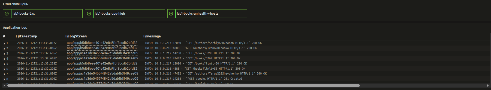
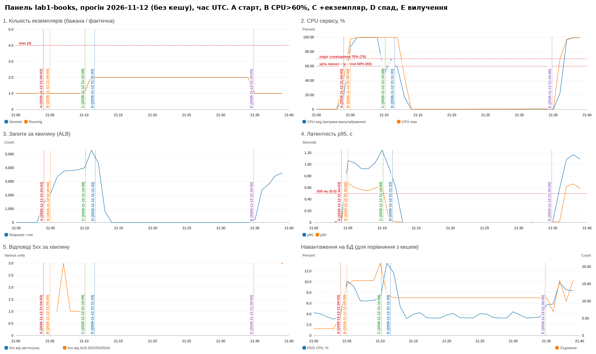

# Автоматичне масштабування і панель моніторингу (завдання 1, 3)

## Політика масштабування

Terraform: [`infra/autoscaling.tf`](../infra/autoscaling.tf), змінні — [`infra/variables.tf`](../infra/variables.tf).

| Параметр | Значення | Де |
|---|---|---|
| Тип | `TargetTrackingScaling` (Application Auto Scaling) | `aws_appautoscaling_policy.cpu` |
| Метрика | `ECSServiceAverageCPUUtilization` — середній CPU по всіх задачах сервісу | |
| Цільове значення | **60 %** | `cpu_target` |
| Мінімум / максимум задач | **1 / 4** | `autoscaling_min`, `autoscaling_max` (перевірка `<= 4`) |
| `scale_out_cooldown` | **60 с** | `scale_out_cooldown` |
| `scale_in_cooldown` | **180 с** | `scale_in_cooldown` |
| Розмір задачі | 0.25 vCPU / 512 MB, 1 процес uvicorn | `aws_ecs_task_definition.app` |

У `aws_ecs_service.app` поле `desired_count` додано до `ignore_changes`: бажану кількість змінює автомасштабування,
і `terraform apply` не повинен скидати її назад.

### Чому ціль 60 %

* **Запас на час реакції.** Новий екземпляр стає корисним лише через 2–4 хв (див. нижче). Поки його немає,
  наявні задачі мають витримати приріст навантаження. При 60 % запас — 40 % потужності, тобто навантаження може
  зрости в ~1.6 раза, перш ніж CPU досягне 100 % і латентність почне різко зростати.
* **Python + 0.25 vCPU.** Один процес uvicorn на малій задачі вже при ~80 % CPU показує зростання черги запитів
  і p95 (виміряно локально з `--cpus 0.25`: при повному завантаженні p95 ≈ 0.9 с).
* **Не надто низько.** Ціль 30–40 % давала б зайві екземпляри майже без навантаження (дорожче, і з максимумом 4
  ми швидко впираємося в стелю). 60 % — компроміс між вартістю і запасом.
* Поріг сповіщення (70 %) свідомо вищий за ціль: якщо масштабування встигає, CPU не тримається вище 70 % дві хвилини
  і лист не надходить; лист означає, що масштабування не впоралось (або досягнуто максимуму).

### Що таке період стабілізації (cooldown)

Після зміни кількості задач метрика ще деякий час «стара»: новий екземпляр стартує, проходить health check ALB,
навантаження на нього розподіляється, і лише потім середній CPU падає. **Cooldown** — час після масштабування,
протягом якого політика вважає, що попередня дія ще не проявилася:

* `scale_out_cooldown = 60` — протягом 60 с після додавання задач нове додавання можливе лише якщо розрахунок
  вимагає *більше*, ніж уже додано (target tracking не скасовує розпочате, лише доповнює);
* `scale_in_cooldown = 180` — після вилучення наступне вилучення не раніше ніж за 3 хв; крім того, scale-in
  блокується, поки йде scale-out cooldown.

**Якщо cooldown = 0**, політика реагує на кожну нову точку метрики, яка ще не відображає результат попередньої дії:
CPU ще високий, бо нова задача не прийняла трафік → додається ще одна і ще одна (перемасштабування до максимуму);
після спаду — вилучення, CPU на решті задач підскакує → знову додавання. Виникають коливання кількості
екземплярів (flapping), зайві старти (кожен — холодний старт і 1–2 хв неповної потужності), обірвані з'єднання при
частих вилученнях і зайві витрати. На AWS ситуацію частково згладжують самі алярми target tracking
(3 хв на scale-out, 15 хв на scale-in), але нульовий cooldown усе одно прибирає «паузу на осмислення» після дії.

### Чому вилучення значно повільніше за додавання

Target tracking створює два CloudWatch-алярми (видно в консолі як `TargetTracking-service/...-AlarmHigh/AlarmLow`):

| Алярм | Умова | Наслідок |
|---|---|---|
| AlarmHigh | CPU > 60 % **3 точки з 3** по 1 хв | додати задачі |
| AlarmLow | CPU < 54 % (90 % цілі) **15 точок з 15** по 1 хв | вилучити задачі |

Асиметрія навмисна: недостатня потужність — це помилки й повільні відповіді для користувачів, а зайвий екземпляр
коштує лише кілька центів на годину. Тому додаємо швидко, вилучаємо обережно — щоб короткий спад (пауза між хвилями
трафіку) не привів до вилучення, за яким одразу знову потрібне додавання.

Розрахунок нової кількості при додаванні: `desired = ceil(current × metric / target)`. При вилученні target tracking
консервативний: прибирає задачі **по одній**, з інтервалом ≥ `scale_in_cooldown` (180 с) + ~1 хв оцінки AlarmLow —
у прогоні з кешем 4→3→2→1 о 22:08:50, 22:12:50, 22:16:50 (див. нижче).

**Запити на екземплярі, що вилучається:** ECS спершу знімає задачу з target group ALB (нові запити туди не йдуть),
чекає `deregistration_delay = 10 с`, поки завершаться поточні, потім надсилає контейнеру **SIGTERM**. Uvicorn
(`--timeout-graceful-shutdown 20`) перестає приймати з'єднання і дообробляє активні запити; через
`stopTimeout = 30 с` ECS надсилає SIGKILL. Тож коректно завершені запити не губляться.

## Панель моніторингу

Terraform: `aws_cloudwatch_dashboard.main` у [`infra/monitoring.tf`](../infra/monitoring.tf).
Посилання: `terraform -chdir=infra output dashboard_url`.

| # | Графік | Метрика |
|---|---|---|
| 1 | Кількість екземплярів: бажана і фактична | `ECS/ContainerInsights` `DesiredTaskCount`, `RunningTaskCount` (потрібен `containerInsights = enabled` на кластері) |
| 2 | CPU, % (лінії 60 % — ціль, 70 % — поріг сповіщення) | `AWS/ECS` `CPUUtilization` Average і Maximum |
| 3 | Запити за хвилину | `AWS/ApplicationELB` `RequestCount` Sum / 60 с |
| 4 | Латентність p95 (і p50), лінія 500 мс | `AWS/ApplicationELB` `TargetResponseTime` p95 |
| 5 | Відповіді 5xx | `HTTPCode_Target_5XX_Count` (застосунок) і `HTTPCode_ELB_5XX_Count` (ALB: немає здорових цілей, тайм-аут) |
| + | Навантаження на БД | `AWS/RDS` `CPUUtilization`, `DatabaseConnections` — для завдання 5 |
| + | Стан алярмів, журнали застосунку | |

Нижня частина панелі в консолі CloudWatch (знімок екрана, 2026-11-12 ~21:13 UTC, кінець першого прогону):

Журнал (CloudWatch Logs Insights по групі `/ecs/lab1-books`) показує запити від **двох різних задач** — потоки
`app/app/b5db8eee…` і `app/app/ac4a3de…`: ALB розподіляє запити між екземплярами, доданими автомасштабуванням.

## Прогін і знімки панелі

Прогін: `./loadtest/run.sh` (див. [LOADTEST.md](LOADTEST.md)), VUS = 60, початок **2026-11-12 21:04:03 UTC** (команда `./loadtest/cache_run.sh off`, кеш вимкнено).

Знімок отримано з тієї самої панелі через `scripts/dashboard_png.py` (CloudWatch `GetMetricWidgetImage`),
вертикальні мітки A–E додано як анотації. Час — UTC.

Позначені моменти:

| Мітка | Час (UTC) | Що видно |
|---|---|---|
| A — початок навантаження | `21:04:03` | графік 3 починає зростати (старт k6) |
| B — перетин порогу CPU 60 % | `21:05` | графік 2: середній CPU 87 % у хвилинній точці 21:05, далі 99–100 % |
| C — поява екземпляра | `21:10:09` | Desired 1→2 (подія Application Auto Scaling); Running = 2 з точки 21:11 |
| D — початок спаду | `21:11:33` | k6 переходить у фазу спаду (+7:30 від старту), графік 3 падає |
| E — вилучення екземпляра | `21:34:50` | Desired 2→1 (AlarmLow спрацював о 21:30:50) |

Що видно на графіках:

* **A→B — 1 хв.** Одна задача 0.25 vCPU насичується вже на початку наростання: CPU avg і max — 100 %,
  p95 росте до ~1 с (графік 4), RDS CPU при цьому лише 6–10 % — вузьке місце саме застосунок.
* **B→C — ~5 хв** (пояснення нижче). Поява другої задачі дає видиме падіння CPU avg до ~50 % у точці 21:10
  і стрибок кількості запитів до ~5300/хв у 21:11 — тепер сервіс обробляє більше, ніж міг один екземпляр.
* **Максимум — 2 екземпляри.** Ціль: `ceil(1 × 99 / 60) = 2`. Наступний крок (до 3) потребував би ще 3 хвилинних
  точок вище 60 % на двох задачах, але о 21:11:33 почався спад.
* **5xx** (графік 5): поодинокі 502/503 від ALB (разом 6 відповідей = 0.02 % у звіті k6) у момент, коли одна задача
  була перевантажена, — від самого застосунку 5xx немає.
* **D→E — 23 хв** = ~2 хв спаду + 15 хв AlarmLow (21:15→21:30:50) + ~4 хв до дії політики.

### Чому між перетином порогу і появою екземпляра минає час

Затримка B→C (у прогоні — ~5 хв: 21:05 → 21:10:09) складається з:

1. **Агрегація метрики:** `CPUUtilization` публікується раз на хвилину і з'являється в CloudWatch із затримкою ~1 хв.
2. **Оцінка аляму AlarmHigh:** потрібні 3 послідовні хвилинні точки вище цілі — ще ~3 хв.
3. **Дія політики:** Application Auto Scaling змінює `desiredCount` (графік 1, Desired) — секунди.
4. **Старт задачі Fargate:** виділення ресурсів, ENI, pull образу з ECR через NAT, запуск uvicorn і підключення до БД — 30–90 с.
5. **Health check ALB:** 2 успішні перевірки з інтервалом 15 с → лише тоді задача отримує трафік і Running/CPU змінюються.

### Чому вилучення відбувається значно пізніше за падіння навантаження

AlarmLow вимагає **15 хвилин поспіль** CPU нижче 54 %, далі — `scale_in_cooldown` і deregistration delay.
Тому після спаду (D) екземпляри зникають лише через ~15–25 хв (E; у прогоні — 23 хв: AlarmLow о 21:30:50, Desired 2→1 о 21:34:50). Це захист від flapping: якщо навантаження
повернеться, екземпляри вже готові. Після кожного тесту слід дочекатися, поки Desired і Running повернуться до 1
(`aws ecs describe-services --cluster lab1-books --services lab1-books --query 'services[0].[desiredCount,runningCount]'`).

У прогоні з кешем (див. [CACHE.md](CACHE.md), `img/dashboard-cache.png`) сервіс дійшов до максимуму 4 задач, і видно,
що вилучення ще й **поступове**: 4→3 о 22:08:50, 3→2 о 22:12:50, 2→1 о 22:16:50 — по одній задачі з інтервалом
не менше `scale_in_cooldown` (180 с) + 1 хв оцінки алярму. Target tracking навмисно консервативний при зменшенні:
різке вилучення кількох задач одразу перевантажило б решту, якщо падіння навантаження виявиться тимчасовим.

**Перерегулювання в прогоні з кешем.** Спад почався о 21:43:07 (+7:30 від старту 21:35:37), а задачі додались
о 21:42:08 (1→2) і 21:44:09 (2→4) — коли навантаження вже падало, а CPU о 21:45 був ≈ 0. Причина — затримка метрики:
політика рішає за хвилинними точками, що приходять із запізненням 1–3 хв. Після появи другої задачі CPU avg був
уже 58–67 % (точки 21:42 і 21:43 на графіку 2), але AlarmHigh спрацював за точками ~100 %, знятими ще на **одній**
задачі, а політика застосувала їх до вже **двох** задач: `ceil(2 × 100 / 60) = 4`. Після цього 4 задачі простояли без роботи до 22:08. Це наочно показує, навіщо потрібні
`scale_out_cooldown` і повільне вилучення: без них сервіс «гойдався» б 4→1→4 на кожному коливанні метрики.
