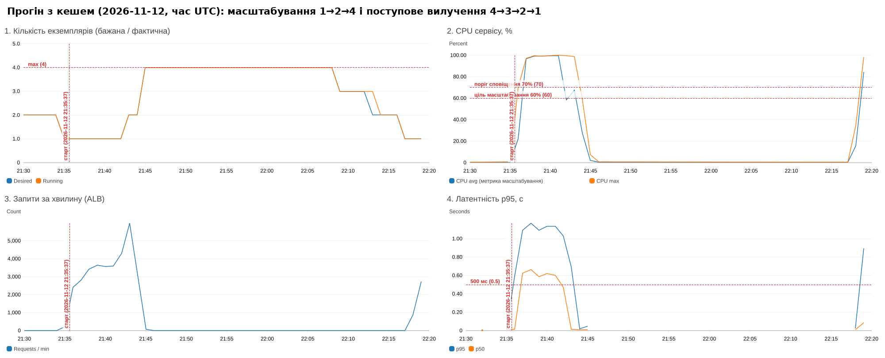

# Кешування операцій читання (завдання 5)

## Що кешується і як

Найбільш навантажена операція — `GET /books?limit=50` (3 з 9 читань у сценарії, найважча: 50 рядків з БД +
серіалізація JSON). Вона переведена на **cache-aside** ([`app/main.py`](../app/main.py) `list_books`,
[`app/cache.py`](../app/cache.py)):

```
GET /books?limit=50&offset=0
  ├─ кеш вимкнено ────────────────────────────── БД → відповідь (X-Cache: BYPASS)
  ├─ Redis GET books:list:50:0 → є ───────────── відповідь з кешу (X-Cache: HIT)
  └─ немає / TTL сплив → БД → Redis SET … EX 30 → відповідь (X-Cache: MISS)
```

* У кеші зберігається вже серіалізований JSON — при влучанні немає ні запиту до БД, ні серіалізації.
* TTL = **30 с** (`cache_ttl_seconds`, перевірка 30–60).
* Якщо Redis недоступний (тайм-аут 0.3 с), сервіс працює напряму з БД — кеш не є точкою відмови.
* `GET /books/{id}` і `/authors/{author}` не кешуються — щойно створену книгу видно одразу.

### Де живе кеш

**Redis 7.4 окремим ECS-сервісом** ([`infra/cache.tf`](../infra/cache.tf)): образ
`public.ecr.aws/docker/library/redis:7.4-alpine`, 0.25 vCPU / 512 MB, `maxmemory 128mb`, `allkeys-lru`, без
персистентності. Доступ лише з SG застосунку на 6379, адреса `redis.lab1-books.local` через Cloud Map (приватна DNS-зона VPC).
Вартість — одна задача Fargate (~$9/міс при цілодобовій роботі) замість ElastiCache ($12–16/міс).

**Чому не кеш у пам'яті процесу.** При 2–4 екземплярах кожен мав би свою копію: (1) частка влучань падає в N разів —
кожен екземпляр окремо «прогріває» кеш і окремо ходить у БД після закінчення TTL; (2) екземпляри віддають різні
версії даних — два послідовні запити того самого клієнта, які ALB розподілив на різні задачі, можуть показати список
«до» і «після» запису (дані «стрибають» назад у часі); (3) інвалідацію після запису неможливо зробити — запис
обробляє один екземпляр, а застарілі копії лежать в інших; (4) новий екземпляр, доданий автомасштабуванням,
стартує з порожнім кешем саме тоді, коли навантаження найбільше; (5) кеш з'їдає пам'ять кожної задачі (512 MB).
Спільний Redis дає один кеш для всіх екземплярів: одне звернення до БД на TTL на ключ, однакові дані для всіх, інвалідація в одному місці.

### Вимикання кешу без передеплою

```bash
TOKEN=$(./scripts/get_token.sh); URL=$(terraform -chdir=infra output -raw app_url)
curl -X PUT "$URL/admin/cache?enabled=false" -H "Authorization: Bearer $TOKEN"   # вимкнути (і скинути лічильники)
curl -X PUT "$URL/admin/cache?enabled=true"  -H "Authorization: Bearer $TOKEN"   # увімкнути
curl "$URL/cache/stats"                                                         # hits/misses + лічильники PostgreSQL
```

Прапорець зберігається в Redis, кожен екземпляр перечитує його раз на 5 с.

## Методика порівняння

```bash
DEMO_EMAIL=... DEMO_PASSWORD='...' ./loadtest/cache_run.sh off
# дочекатися повернення до 1 екземпляра (~15–20 хв)
DEMO_EMAIL=... DEMO_PASSWORD='...' ./loadtest/cache_run.sh on
```

Скрипт перемикає кеш, знімає `/cache/stats` до і після прогону та друкує приріст лічильників PostgreSQL
(`pg_stat_database`): `xact_commit` — кількість транзакцій (≈ запитів до БД), `tup_returned` — прочитано рядків.
Додатково з панелі — RDS CPU і максимальна кількість екземплярів.

## Результати

Хмара (AWS), 60 VU, повний сценарій (фази 2:30 / 5:00 / 2:00), 2026-11-12:
без кешу — старт 21:04:03 UTC, з кешем — старт 21:35:37 UTC (після повернення до 1 екземпляра).
Джерела: `loadtest/results/cache-{off,on}-*.md` (k6), `cache-{off,on}-*.json` (`/cache/stats`), панель (RDS CPU, екземпляри).

| Показник | Без кешу | З кешем |
|---|---|---|
| Латентність p95 (усі запити) | 1032 мс | 1132 мс |
| Латентність p95 `GET /books` | 1027 мс | **896 мс** (−13 %) |
| Латентність p50 (усі запити) | 520 мс | **425 мс** (−18 %) |
| Запитів за секунду | 56.4 | 57.7 |
| Транзакцій у БД (`xact_commit`), однаковий інтервал +5:20…кінець прогону¹ | 18 563 | **13 788** (−26 %) |
| Прочитано рядків (`tup_returned`), той самий інтервал¹ | 9.1 млн | 20.4 млн² |
| RDS CPU, пік % (хвилинний максимум) | 13.5 % | 11.7 % |
| Макс. екземплярів | 2 | 4 |
| **Частка влучань у кеш** | — | **99.0 %** (9 800 hit / 98 miss) |

¹ Лічильники PostgreSQL для прогону без кешу знято з 21:09:23 (+5:20 від старту), а не з початку (знімок «до»
випадково перезаписано повторним запуском скрипта). Тому для чесного порівняння в прогоні з кешем знято додатковий
знімок на тій самій позиції +5:20 (`cache-on-mid.json`). За весь прогін з кешем: `xact_commit` +26 592.

² `tup_returned` зріс не через кеш: кожен прогін додає ~3 300 книг, а `GET /authors/{author}` (2 з 9 читань)
рахує книги автора без індексу по `author` — послідовне сканування всієї таблиці, що росте. Індекс
`CREATE INDEX ON books(author)` прибрав би це зростання.



### Висновки з порівняння

* **Кеш працює і розвантажує БД:** 99 % запитів `GET /books` обслуговує Redis, після закінчення TTL у БД іде
  кілька одночасних запитів: 98 промахів за 9.5 хв ≈ 19 вікон TTL × ~5 конкурентних запитів, які встигли прийти,
  поки перший ще не записав нове значення (маленький cache stampede). Транзакцій у БД на тому самому інтервалі
  стало на чверть менше — рівно частка `GET /books` у сценарії, яку тепер не обробляє БД.
* **На загальній латентності це майже не видно, бо вузьке місце — не БД, а CPU застосунку.** RDS CPU в обох
  прогонах ≤ 14 %, а CPU задач 0.25 vCPU — 96–100 %. Кожен запит усе одно проходить перевірку JWT, роутинг FastAPI і
  (крім влучань) серіалізацію — кеш прибирає лише запит до БД і серіалізацію списку. Тому p50 і p95 `GET /books`
  покращились, а p95 усіх запитів визначається чергою на перевантаженому CPU і залежить від того, як швидко
  додались екземпляри (у прогоні з кешем ціль спрацювала пізніше, о 21:42, зате одразу до 2, потім до 4).
* Кеш дав би більший виграш, якби БД була вузьким місцем (повільні запити, багато рядків, слабкий екземпляр RDS) —
  саме цей випадок він і захищає: при зростанні кількості екземплярів застосунку навантаження на БД від списку
  книг лишається сталим (~1 запит на TTL), а не росте пропорційно трафіку.

Локальне калібрування (1 екземпляр 0.25 vCPU, 60 VU, скорочені фази) — довідково:

| Показник | Без кешу | З кешем |
|---|---|---|
| p95 (усі запити) | 907 мс | 705 мс |
| p95 `GET /books` | 903 мс | 500 мс |
| Запитів за секунду | 65.8 | 73.5 |
| Частка влучань у кеш | — | **99.1 %** (1481 hit / 13 miss) |

Частка влучань близька до `1 − (кількість ключів × тривалість / TTL) / кількість запитів`: один ключ
`books:list:50:0`, один промах на 30 с, решта — влучання.

## Скільки часу клієнт бачить застарілі дані

Після `POST /books` нова книга з'явиться у `GET /books` **не пізніше ніж через TTL = 30 с** (у середньому ~15 с):
закешована версія списку живе до закінчення свого TTL, запис її не змінює. `GET /books/{id}` не кешується,
тож сам клієнт одразу бачить створений об'єкт.

Як зменшити:

1. **Менший TTL** — лінійно зменшує застарілість, але збільшує частку промахів і навантаження на БД.
2. **Інвалідація при записі** — після `commit()` у POST/PUT/DELETE видаляти ключі списку (`DEL`, або
   версіонування: `INCR books:list:version` і включати версію в ключ, щоб не шукати всі `books:list:*`).
   Застарілість падає до ~0, але при профілі 1:9 під навантаженням кеш списку скидатиметься кілька разів на
   секунду, і частка влучань різко впаде — для «гарячого» списку, що змінюється при кожному записі, це майже
   рівнозначно вимкненню кешу.
3. **Write-through** — при записі одразу оновлювати закешований список (додати нову книгу на початок).
4. **Read-your-writes на клієнті** — клієнт, що щойно створив запис, додає його до списку локально або
   обходить кеш (заголовок / параметр), а для інших користувачів 30 с затримки прийнятні.

Обраний компроміс: TTL 30 с без інвалідації — для каталогу книг застарілість у 30 с прийнятна, а БД отримує
1 запит списку на 30 с замість сотень на секунду.
