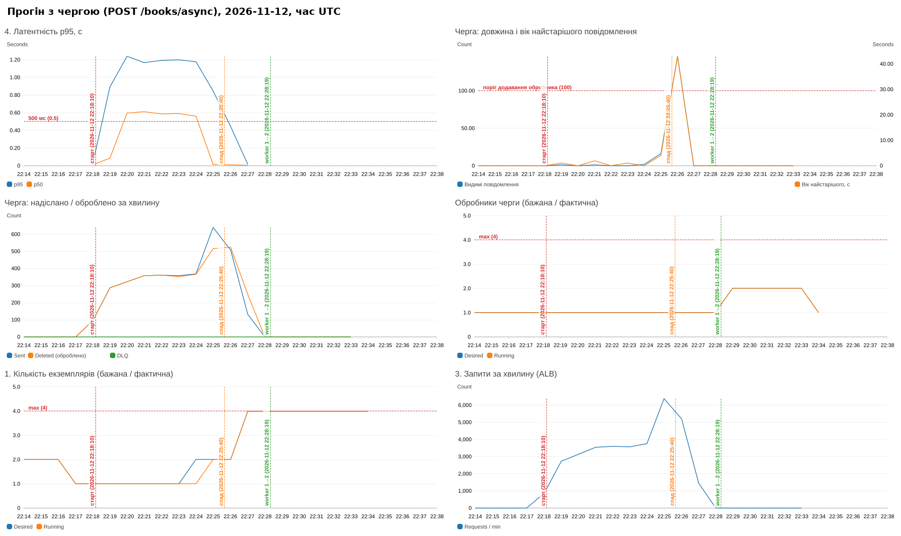

# Асинхронна обробка через чергу (бонус 6)

## Архітектура

```
клієнт ──POST /books/async──► ALB ► app (ECS, 1–4) ──SendMessage──► SQS lab1-books-books ──► worker (ECS, 1–4)
   ◄── 202 {operation_id} ───┘           │                                │ 5 невдалих спроб        │ INSERT operations + books
                                         └ Redis op:<id> = pending        ▼                         ▼ (одна транзакція)
клієнт ──GET /operations/{id}──► app ──► Postgres: є рядок operations? → done + книга; інакше Redis → pending
                                                                     SQS DLQ lab1-books-books-dlq
```

| Компонент | Де |
|---|---|
| Черга SQS + DLQ (`maxReceiveCount = 5`, visibility timeout 30 с, long polling 20 с) | [`infra/queue.tf`](../infra/queue.tf) |
| `POST /books/async` → 202, `GET /operations/{id}` | [`app/main.py`](../app/main.py), [`app/queue.py`](../app/queue.py) |
| Обробник `python -m app.worker` — той самий образ, окремий ECS-сервіс з власною IAM-роллю (лише Receive/Delete) | [`app/worker.py`](../app/worker.py), `aws_ecs_service.worker` |
| Масштабування обробника від довжини черги | `aws_appautoscaling_policy.worker_out/worker_in` + алярми `queue_backlog_high/low` |
| CD оновлює обидва сервіси | [`.github/workflows/deploy.yml`](../.github/workflows/deploy.yml) |
| Локально: ElasticMQ (SQS-сумісний) + worker | [`compose.yaml`](../compose.yaml), [`local/elasticmq.conf`](../local/elasticmq.conf) |

«Тривала» частина операції імітується затримкою `WORKER_WORK_SECONDS` (0.1 с на повідомлення, `worker_work_seconds`) —
як зовнішній виклик (перевірка ISBN, генерація обкладинки). Застосунок відповідає, не чекаючи на неї.

### Масштабування обробника

Метрика — `ApproximateNumberOfMessagesVisible` (видимі, ще не взяті повідомлення). Використано **step scaling**:
довжина черги не є метрикою «на екземпляр», тому target tracking з нею без метричної математики поводиться некоректно.

| Алярм | Умова | Дія |
|---|---|---|
| `queue-backlog-high` | > 100 повідомлень, 1 хв | +1 обробник (+2, якщо > 1000), cooldown 60 с; повторюється, поки алярм у стані ALARM |
| `queue-backlog-low` | ≤ 10 повідомлень 5 хв поспіль | −1 обробник, cooldown 120 с, до мінімуму 1 |

Розрахунок: 60 VU × ~1 запис за ітерацію (~3.3 с) ≈ 18 записів/с; один обробник — ~9 повідомлень/с
(0.1 с роботи + запис у БД). Черга росте, додаються 2–3 обробники, після спаду черга спорожняється і обробники вилучаються.

## Прогін

```bash
WRITE_MODE=async LABEL=async DEMO_EMAIL=... DEMO_PASSWORD='...' ./loadtest/run.sh
```

У режимі `async` сценарій робить `POST /books/async` (очікує 202) і замість читання щойно створеної книги
запитує `GET /operations/{id}`; коли операція `done` — читає книгу за id. Решта (9 читань) — без змін.



Прогін: 2026-11-12, старт 22:18:10 UTC, `WRITE_MODE=async LABEL=async ./loadtest/run.sh`, 60 VU, кеш увімкнено
(результат: `loadtest/results/async-2026-11-12T22-27-47-133Z.md`). Знімок — `scripts/dashboard_png.py`, час UTC.

Що видно на панелі:

| Що показати | Графік | Спостереження |
|---|---|---|
| Запис у чергу не залежить від БД | «Черга: надіслано / оброблено» | 290–370 повідомлень/хв на сталому навантаженні, Deleted іде слідом за Sent з відставанням < 1 хв |
| Черга росте під навантаженням | «Черга: довжина» | на 1 задачі застосунку — 0–2 повідомлення (обробник встигає); після масштабування застосунку до 4 задач (22:24–22:26) потік записів зріс до ~640/хв і черга виросла до **146** повідомлень о **22:26**, вік найстарішого — 43 с |
| Обробники масштабуються | «Обробники черги» | алярм `queue-backlog-high` (> 100) → 1 → **2** о **22:28:19**; назад до 1 о **22:33:27** (5 хв з чергою ≤ 10) |
| Усе оброблено | «надіслано / оброблено», DLQ | Sent = Deleted = **3 429** (рівно кількість ітерацій k6), DLQ = 0 |

| Показник (k6), 60 VU, кеш увімкнено | sync (`POST /books`, прогін 21:35) | async (`POST /books/async`, прогін 22:18) |
|---|---|---|
| p95 запису | 1229 мс | **872 мс** (−29 %) |
| p95 усіх запитів | 1132 мс | 1136 мс |
| Запитів за секунду | 57.7 | 60.1 |
| Частка помилок | 0.02 % | 0.01 % |

Чому p95 запису не впав до мілісекунд, як локально: у хмарі вузьке місце — CPU самих задач застосунку
(0.25 vCPU, 96–100 % на піку), і запит `POST /books/async` стоїть у тій самій черзі uvicorn, що й читання.
Сама операція (валидація + `SendMessage` у SQS) коротка — тому запис став на третину швидшим за синхронний
(INSERT у БД виконує обробник, а не застосунок), а p95 усіх запитів визначається насиченням CPU, як і в інших прогонах.
Латентність застосунку не зростає разом з довжиною черги: пік черги (146 повідомлень о 22:26) припадає на момент,
коли p95 застосунку якраз падає — накопичення бере на себе черга, а не клієнт.

Обробник масштабувався із запізненням: другий обробник з'явився о 22:28:19, коли один уже розібрав пік
(черга порожня з 22:27). Затримка — 1 хв агрегації метрики SQS + оцінка алярму + старт задачі Fargate.
Механізм працює, але для піків коротших за ~2–3 хв масштабування обробника не встигає — і не мусить:
черга просто розтягує обробку в часі. Для довгого сталого потоку записів обробників ставало б більше.

Локальна перевірка (compose, 30 VU, скорочені фази): p95 `POST /books/async` = 7.5 мс, p95 усіх запитів = 9.5 мс, 0 % помилок.

## Що змінилося для клієнта

* Замість `201 Created` з книгою — **`202 Accepted`** з `operation_id`, `status_url` і заголовком `Location: /operations/<id>`.
  202 означає «прийнято до обробки», а не «створено»: операція ще може завершитися невдачею.
* Відповідь швидка й не залежить від навантаження на БД/обробник — запис у чергу займає мілісекунди, а черга
  поглинає сплески.
* **Eventual consistency:** одразу після 202 книги ще немає ні в `GET /books`, ні за id; `id` книги клієнт
  дізнається лише після обробки.

### Як клієнт дізнається результат

Опитуванням (polling) `GET /operations/{operation_id}`:

```json
{"operation_id": "5828…", "status": "pending", "book": null}
{"operation_id": "5828…", "status": "done", "book": {"id": 1077, "title": "Async", …}}
```

`pending` — повідомлення ще в черзі (маркер `op:<id>` у Redis на 24 год), `done` — рядок у таблиці `operations`
разом із книгою, `404` — невідома операція. Альтернативи polling: webhook (сервер викликає URL клієнта),
WebSocket/SSE, повідомлення в окремій черзі/топіку відповідей.

**Обмеження:** маркер `op:<id>` = `pending` зберігається в Redis без персистентності. Якщо задачу Redis перезапустити,
поки операція ще в черзі, `GET /operations/{id}` поверне **404** замість `pending` (запис у таблиці `operations`
з'являється лише після обробки). Сама операція не губиться — обробник її виконає, і далі статус буде `done`.
Надійніше — створювати рядок `operations` зі статусом `pending` у БД ще в `POST /books/async`.

## Доставка «щонайменше один раз»

SQS гарантує, що повідомлення не загубиться, але **не гарантує**, що його отримають лише один раз.
Повідомлення після `ReceiveMessage` стає невидимим на visibility timeout (30 с) і видаляється лише явним
`DeleteMessage` після успішної обробки. Якщо обробник упав (SIGKILL під час scale-in, помилка БД) або не встиг
за 30 с — повідомлення знову стає видимим і його отримає інший обробник. Крім того, Standard-черга зрідка може
доставити копію навіть без збою. Після 5 невдалих спроб повідомлення переходить у DLQ, щоб «отруйне» повідомлення
не оброблялось нескінченно.

## Що буде при повторній обробці

Найнебезпечніший випадок: обробник зробив commit у БД і впав до `DeleteMessage` — повідомлення повернеться, і без
захисту книга створилася б двічі. Захист — **ідемпотентний обробник**: `operation_id` з повідомлення є первинним
ключем таблиці `operations`, і в одній транзакції виконується

```sql
INSERT INTO operations (id) VALUES (:operation_id) ON CONFLICT (id) DO NOTHING RETURNING id;  -- немає рядка → дубль
INSERT INTO books (...) ...;  UPDATE operations SET book_id = ...;
```

Якщо рядок уже є — це повтор: обробник нічого не робить, лише видаляє повідомлення (у журналі
`operation … already processed — duplicate skipped`). Оскільки обидва INSERT в одній транзакції, ситуація
«операцію позначено, а книги немає» неможлива. Перевірка — [`tests/test_queue_redelivery.py`](../tests/test_queue_redelivery.py)
надсилає те саме повідомлення двічі:

```
OK: operation 64d28cae-f4f2-4619-b99f-6d6c44345b94 delivered twice, books by redelivery-64d28cae: 1
worker: operation 64d28cae-… already processed (receive #1) — duplicate skipped
```

Повтори з боку клієнта (повторний POST після тайм-ауту) закриває `Idempotency-Key` — див. [IDEMPOTENCY.md](IDEMPOTENCY.md).

Коректне завершення обробника: на SIGTERM він дообробляє поточну пачку (≤ 10 повідомлень) і виходить; якщо не встиг —
необроблені повідомлення повернуться в чергу після visibility timeout.
